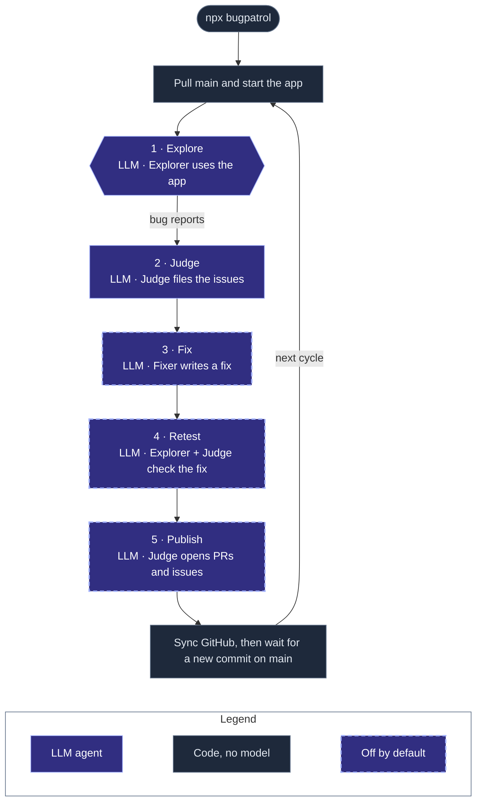
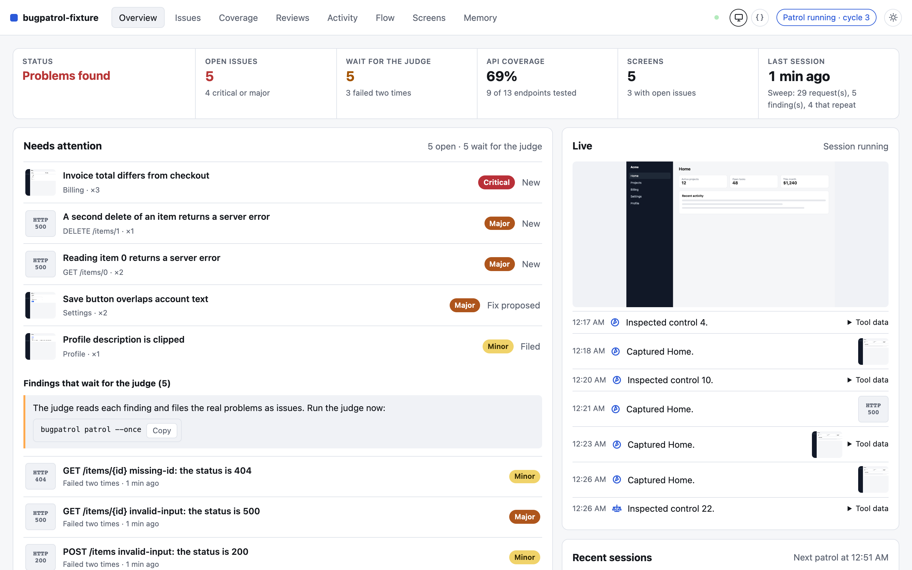

<p align="center">
  
</p>

<p align="center">
  <a href="https://www.npmjs.com/package/bugpatrol"></a>
  <a href="https://github.com/agent-labs-dev/bugpatrol/actions/workflows/ci.yml"></a>
  <a href="LICENSE"></a>
</p>

Bugpatrol is a QA team made of agents. It uses your web, desktop, or mobile app, HTTP API, or CLI the way a tester does. It finds bugs, fixes them, checks each fix in the running app, and opens the pull requests and issues for your team. The [Nebula](https://nebula.gg) team uses it every day on our own apps, and we made it open source for all teams.

- An **explorer** agent runs the app, maps its screens, and reports what looks wrong.
- A **judge** agent decides which reports are real bugs, and writes the issues.
- A **fixer** agent writes a fix in its own git worktree.
- The explorer and the judge **retest** each fix in the running app.
- Bugpatrol **publishes** to GitHub: a PR for each fix, and an issue for each major bug with no fix.

```bash
npx bugpatrol
```

`npx bugpatrol` runs the patrol: explore, judge, fix, retest, and publish, again and again. The fixer and GitHub stay off until you turn them on.



[How it works](docs/how-it-works.md#the-patrol) tells when the patrol runs, and shows each step of the explore loop.



<p align="center"><em>The dashboard (<code>npx bugpatrol dashboard</code>) shows what each agent does, live.</em></p>

## Set up with your agent

1. Install the Bugpatrol skill in your repo, and commit the skill and `skills-lock.json`:

   ```bash
   npx skills add agent-labs-dev/bugpatrol
   ```

2. Give this prompt to your agent:

   ```text
   Set up Bugpatrol for this repo.
   ```

If your agent cannot install skills, give it the skill URL:

```text
Read https://raw.githubusercontent.com/agent-labs-dev/bugpatrol/main/skills/bugpatrol/SKILL.md and set up Bugpatrol for this repo.
```

To set up Bugpatrol by hand, read [Getting started](docs/getting-started.md).

## What is supported

| Area | Supported |
| --- | --- |
| Platforms | Web (Playwright), Electron (CDP), iOS simulator and Android emulator (Maestro), Linux desktop apps through Cua and Xvfb, HTTP APIs and CLIs |
| Agent LLMs | Claude Code, Codex, Kimi CLI, opencode, pi, or any CLI agent; or an API key for OpenRouter, Vercel AI Gateway, OpenAI, Anthropic, or a custom endpoint |
| GitHub | PRs, issues, state sync, and pull request reviews in CI, through the `gh` CLI |
| Output | A local dashboard, GitHub PRs and issues, and JSON files under `.bugpatrol/runs/` |

## Documentation

| Page | What it covers |
| --- | --- |
| [Getting started](docs/getting-started.md) | The requirements, and the setup by hand, step by step |
| [Commands](docs/commands.md) | All the CLI commands |
| [Configuration](docs/configuration.md) | All the settings in `.bugpatrol/bugpatrol.yml` |
| [LLMs](docs/models.md) | The providers for each agent, and the model that we recommend for each agent |
| [The dashboard](docs/dashboard.md) | What each page shows, and the files behind it |
| [How it works](docs/how-it-works.md) | The patrol, the cycle, noise control, memory, and safety |
| [GitHub](docs/github.md) | PRs and issues, the state sync, and pull request reviews in CI |
| [The deterministic gate](docs/deterministic-gate.md) | `bugpatrol run`: a merge gate for web apps that uses no agent |
| [Development](docs/development.md) | Build Bugpatrol from source, the packages, and the examples |
| [Bughunters](docs/bughunters.md) | The earlier name of Bugpatrol, and how to move a repo to the new names |

## License

[Apache-2.0](LICENSE)

---

<p align="center">Made with ❤️ by the <a href="https://nebula.gg">Nebula</a> team.</p>
